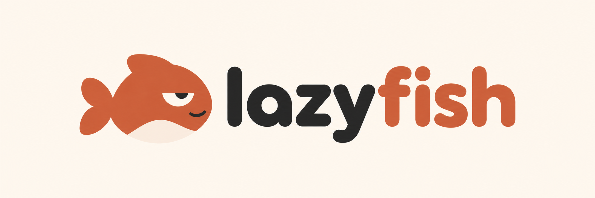
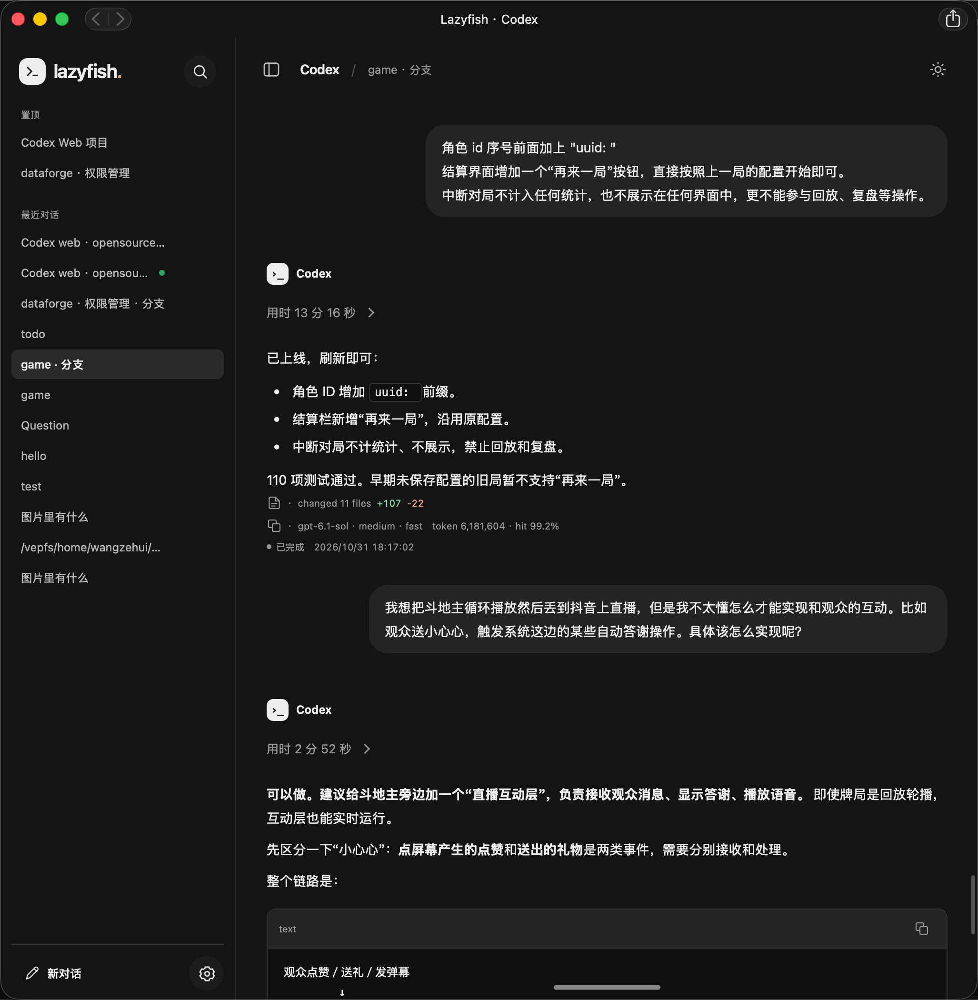
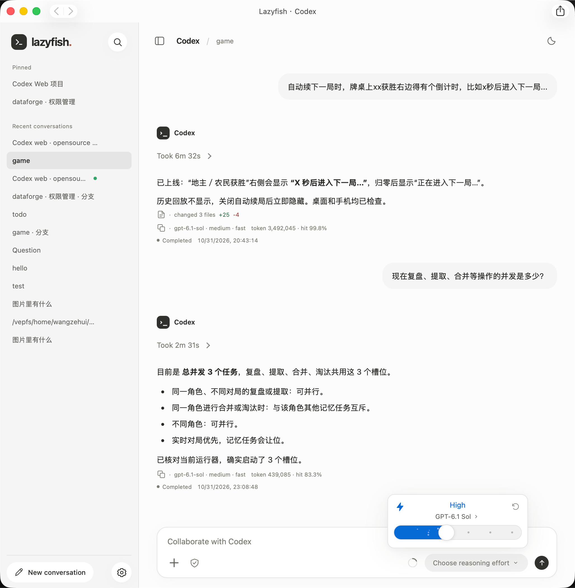

# Lazyfish

<p align="center">
  
</p>

[简体中文](README.zh-CN.md) · [Configuration](docs/configuration.md) · [Architecture](docs/architecture.md) · [Roadmap](docs/roadmap.md)

A lightweight, self-hosted web companion for an existing **Codex CLI** installation.
The Web service and CLI run on the **same machine**. Use a browser locally, on a
trusted LAN (opt-in), or through an SSH tunnel from another device. No separate execution worker or second server is required.

Manage conversations, follow task progress, work with files and images, and choose the models, themes and shortcuts that suit your workflow.

Lazyfish is an independently developed third-party project. It is not affiliated with, sponsored by, or endorsed by OpenAI. OpenAI, Codex, ChatGPT, and other referenced trademarks belong to their respective owners.

## Interface preview

| Dark mode · 中文 | Light mode · English |
| --- | --- |
|  |  |

## Why choose Lazyfish?

If you prefer using Codex in a browser or switching between devices, Lazyfish offers a lightweight, self-hosted way to do it.

- **Open a page instead of installing another desktop app**: each device can use its existing browser, without downloading and maintaining a separate desktop client or runtime. On the server, Lazyfish uses the Python standard library with no additional Python runtime dependencies.
- **Work from computers, phones and embedded devices with compatible browsers**: the interface adapts to different screen sizes. Use a computer for project work or a phone to check progress and send follow-up instructions. Tablets and embedded devices with a browser supporting modern web features can also act as access terminals. Codex and its tasks run on the service machine; browsing devices do not need the CLI.
- **Less repeated loading**: static asset caching, parallel initial requests and cached recent conversation views reduce repeated work when refreshing or switching chats. Long histories load in pages, execution details load on demand, and usage panels show saved records while updating in the background.
- **Tasks stay on the server, with access across devices**: connect to the same service through secure remote access to view saved conversations, generated files and task progress. Closing the browser does not interrupt a task; return later to follow its progress.
- **Use ChatGPT sign-in or your own API key**: Lazyfish connects through Codex CLI, supporting both ChatGPT sign-in and your own OpenAI API key in a browser interface. API key usage is billed separately under API pricing; feature availability depends on your account and CLI. See the [official authentication guide](https://learn.chatgpt.com/docs/auth).
- **Your machine and your workspace**: choose where to run the service and which project directories to use, with your existing Codex login and configuration. Conversations and attachments stay on your service machine. Adjust themes, language and shortcuts to suit your workflow.

These optimizations improve page loading, interaction and access. Model generation speed still depends on the selected model, provider and network.

## Requirements

- Linux or macOS, Python **3.11–3.14**, `venv` and `pip`. No runtime Python dependencies.
- A Codex CLI with `app-server` support, available to the same OS user. The
  CLI is installed and authenticated separately; existing installations are reused.
- Authenticate with your chosen native Codex login method, or use the Web account panel before chatting.
  See [Codex authentication](https://learn.chatgpt.com/docs/auth).
- An optional project directory; leave the workspace empty to use a private default workspace.

Codex is not bundled or installed by Lazyfish. An existing CLI login is reused;
a separate OpenAI API key is **not required** when your native login already works.
API-key setups and proxies remain user configuration, not project defaults.

## Quick start

From a downloaded/cloned checkout:

```bash
bash scripts/install.sh
# If prompted, run the printed source command first.
lazyfish token
lazyfish serve
```

Open **http://127.0.0.1:3210** and paste the **Web token** printed by `lazyfish token`.
This token is separate from your Codex/OpenAI credentials. The installer generates
it automatically and never prints it. The page supports English and Chinese.
The default bind address is `127.0.0.1` (local access only). For another device,
see [remote access](#remote-access) below; LAN access is opt-in and still requires the Web token.

The installer creates `~/.local/bin/lazyfish`; its Python environment stays isolated
internally. If that directory is missing from PATH, it updates your Bash/Zsh startup
file and prints the `source` command to run once in the current terminal. Run that
command before using `lazyfish` (or open a new terminal). Reinstalling updates the
managed launcher without duplicating PATH configuration; unrelated existing commands
are not overwritten. Keep the installation directory in place.
Workspace configuration defaults to empty. Tasks without a selected directory use
`workspace/` under the data directory; optionally pass `--workspace /path/to/project`
to the installer to restrict work to an existing project directory.

The installer installs Lazyfish and initializes private configuration and data only.
Install and sign in to Codex separately using the [official CLI documentation](https://learn.chatgpt.com/docs/codex/cli).
If `codex` is not on PATH, provide its executable path when starting Lazyfish:

```bash
LAZYFISH_CODEX_BIN=/path/to/codex lazyfish serve
```

Alternatively, set `binary` under `[codex]` in `config.toml`. Existing CLI login is reused.

It needs no `sudo`, installs no system
service and starts no background daemon. `serve` runs in the foreground; stop it
with Ctrl+C or, from another terminal:

```bash
lazyfish status
lazyfish stop
```

If `python3` is too old, select an existing newer interpreter:

```bash
PYTHON=/path/to/python3.14 bash scripts/install.sh
```

## Remote access

**Trusted LAN:** in your local `~/.config/lazyfish/config.toml` (or your selected
config), change `host` under `[server]` to `"0.0.0.0"`, then restart the service:

```toml
[server]
host = "0.0.0.0"
```

Startup prints the localhost URL and detected private IPv4 URLs. Open a LAN URL
from the other device and sign in with `lazyfish token`. Common container/bridge
interfaces are omitted from the banner. To bind only one interface, set its private
IPv4 instead (for example `192.168.1.10`). See [configuration](docs/configuration.md).

`0.0.0.0` listens on **all IPv4 interfaces**, not just the LAN. Use only on a trusted
network and restrict access with a firewall; HTTP does not encrypt tokens or traffic.
Public bind addresses and non-local Host headers are rejected, but those checks are
**not a firewall**. Do not expose the service to the public internet or forward its
port on a router. Use SSH on untrusted networks.

**SSH alternative:** leave the default `127.0.0.1` binding and forward its port:

```bash
ssh -N -L 3210:127.0.0.1:3210 user@your-server
```

Then open `http://127.0.0.1:3210` locally and sign in with the Web token.
A workspace is an execution context, **not an OS sandbox**; use a dedicated OS
user for files you intend to expose to an agent.

## Features

- **Codex in your browser**: connect to an existing Codex CLI installation on the same machine, using your current login and project directories. No desktop client or separate execution server is needed.
- **Conversations and history search**: create, rename, pin and reorder conversations. Search titles and message content, and return to your reading position after switching chats or refreshing.
- **Message editing and branches**: edit a sent message or branch from an earlier point to explore another approach. Branching keeps the source conversation for reference. Editing and branching do not roll back workspace files.
- **Parallel tasks and execution controls**: run tasks across different conversations, with concurrency adjustable from 1 to 16 in Diagnostics. Refreshing, switching chats or closing a tab does not stop a task. Send supplementary instructions while it runs, or stop it and retain the output already received.
- **Readable progress and results**: stream replies with Markdown, tables, copyable code and collapsible execution details. Inspect commands, web results, file changes and diffs; preview generated images and download files linked in replies. Absolute local Markdown paths render as named links: click to copy the server path or open it in VS Code on your browser device. Paths with spaces, parentheses and line numbers are supported; remote paths need a matching remote workspace. Image outputs use compact thumbnails with click-to-enlarge previews. Images already shown inline are not repeated below the reply; text links keep their image thumbnails visible.
- **Models, reasoning and permissions**: choose a model, reasoning effort, fast/standard speed and permission mode from the composer. Use Plan mode to review an approach before implementing it, and answer clarification or approval requests directly in the page.
- **Images, skills and connected tools**: upload, paste or drag images into a message. Select skills with `@`, `$` or the add menu; create and edit project or personal skills. Inspect MCP tools and connection status, and authorize services that support OAuth.
- **Accounts, usage and context**: sign in with a device code, browser or API key. View available quota, reset times and usage history, monitor context usage and compact it manually when needed. Availability depends on your CLI version, account and provider.
- **Themes, languages and shortcuts**: switch between English and Chinese, choose from eight palettes, and use light, dark or system appearance. Customize send, newline and conversation shortcuts. Hold your shortcut prefix to see switching hints, including a compact conversation picker when the sidebar is hidden.

See the [feature guide](docs/features.md) for detailed behavior and limits, and [configuration](docs/configuration.md) for installation and runtime options.

## Commands

| Command | Purpose |
| --- | --- |
| `lazyfish init [--workspace PATH]` | Initialize; preserve existing configuration and token |
| `lazyfish doctor` | Check executable, stored login, workspace and app-server command |
| `lazyfish doctor --probe --json` | Also initialize and close an owned app-server; no inference |
| `lazyfish serve` | Start the chat service in the foreground |
| `lazyfish status` | Query the authenticated instance for this data directory |
| `lazyfish stop` | Stop that instance gracefully; never signal a PID from a stale file |
| `lazyfish token` | Reveal the Web sign-in token deliberately in your terminal |

Ordinary commands find the default configuration automatically. If no default
exists, the first successfully initialized/used custom configuration is remembered
for later commands, including from another directory. No repeated `--config` is
needed. Use `lazyfish --config /path/to/config.toml COMMAND` or `LAZYFISH_CONFIG`
only to override that selection, such as for another instance.
Configuration changes require restarting `serve`. After
installing the CLI or changing its login, use **Installation → Check again** or the
Diagnostics header refresh to rerun local checks without restarting. Web account
login/logout automatically refreshes these checks. Refreshing native account,
usage, skills or connections panels queries an owned, short-lived CLI process;
these metadata reads do not create threads or start inference.

`doctor` checks local installation and the CLI's saved login status. Even a passing
`--probe` only verifies protocol initialization. It does **not** test network access,
model access, billing, or guarantee every future chat API is compatible.

## Files and privacy

| Location (XDG defaults) | Contents |
| --- | --- |
| `~/.config/lazyfish/config.toml` | Workspace, data directory, executable, port and log level |
| `~/.config/lazyfish/secrets.env` | Generated Web token and optional private environment settings |
| `~/.local/share/lazyfish/` | SQLite conversations/tasks/events, logs, runtime ownership and uploaded image bytes, attachment materializations and context snapshots |
| Existing Codex home / OS credential store | Native CLI authentication; Lazyfish does not copy or edit it |

Application directories are private (`700`) and config/secrets/data files are
private (`600`). Configuration and secrets with unsafe permissions are rejected. Filled-in
environment files, databases, logs and runtime data are excluded from Git.
No analytics, CDN resources, account credentials or production deployment hooks
are included. The browser stores authentication in an HttpOnly session cookie,
not local storage. Only language, shortcut/sidebar preferences, bounded message
IDs/scroll geometry, appearance and expanded-tool IDs are saved in browser local storage;
message bodies and tokens are not. Sanitized quota/activity snapshots are additionally cached under a native account scope. Restarting the service invalidates browser sessions.

See [configuration](docs/configuration.md), [deployment](docs/deployment.md),
[troubleshooting](docs/troubleshooting.md) and [security](SECURITY.md).

## Development

```bash
python3.11 -m venv .venv
.venv/bin/python -m pip install -e .
.venv/bin/python -m unittest discover -s tests -v
.venv/bin/python -m pip install build
.venv/bin/python -m build
```

Tests use isolated directories and fake Codex executables; no real inference or
credentials are required. CI tests Python 3.11–3.14, runs isolated Chromium UI checks and builds/installs a wheel.
See the optional local browser-test commands in [CONTRIBUTING.md](CONTRIBUTING.md).
See [CONTRIBUTING.md](CONTRIBUTING.md). Project code is MIT licensed; Codex and
third-party services keep their own licenses and terms.
