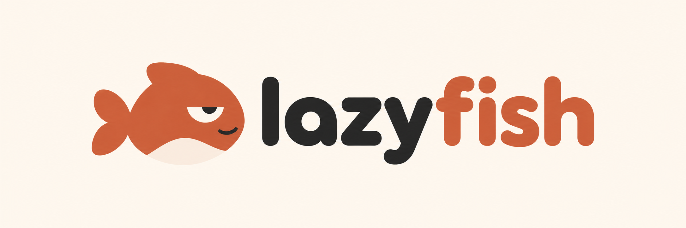
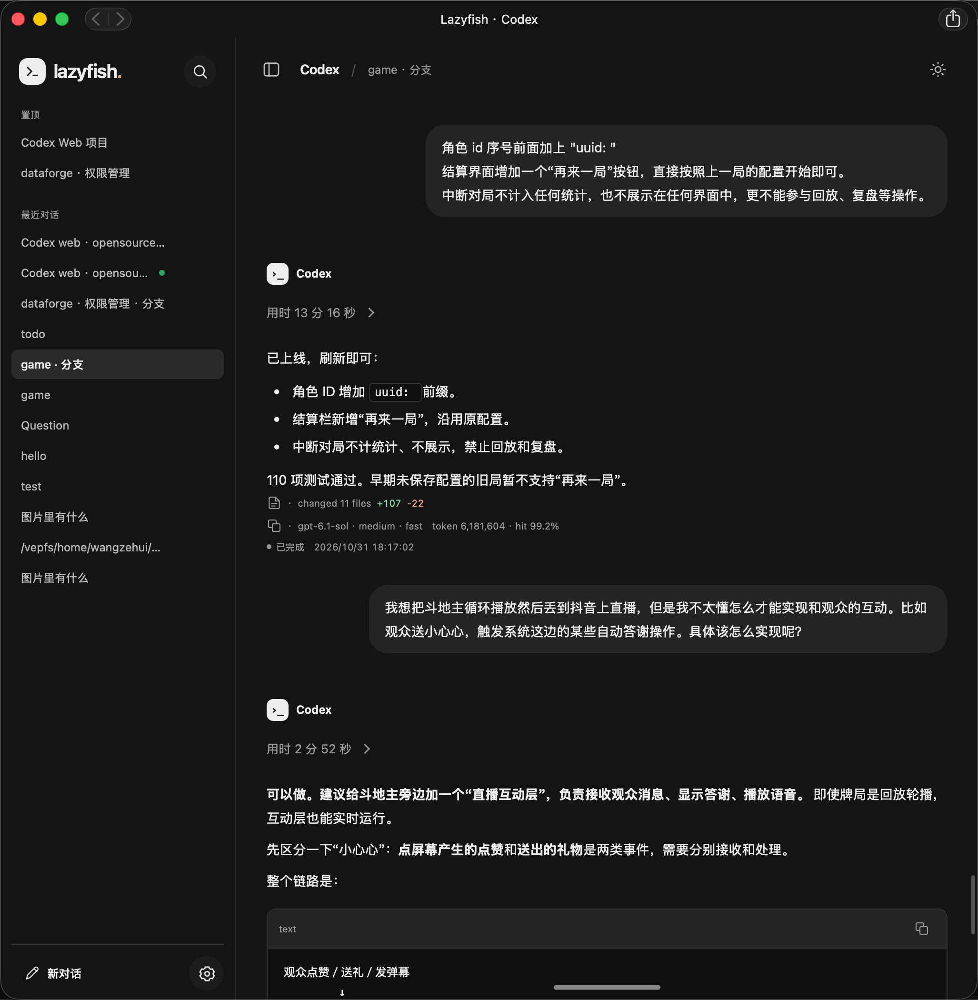
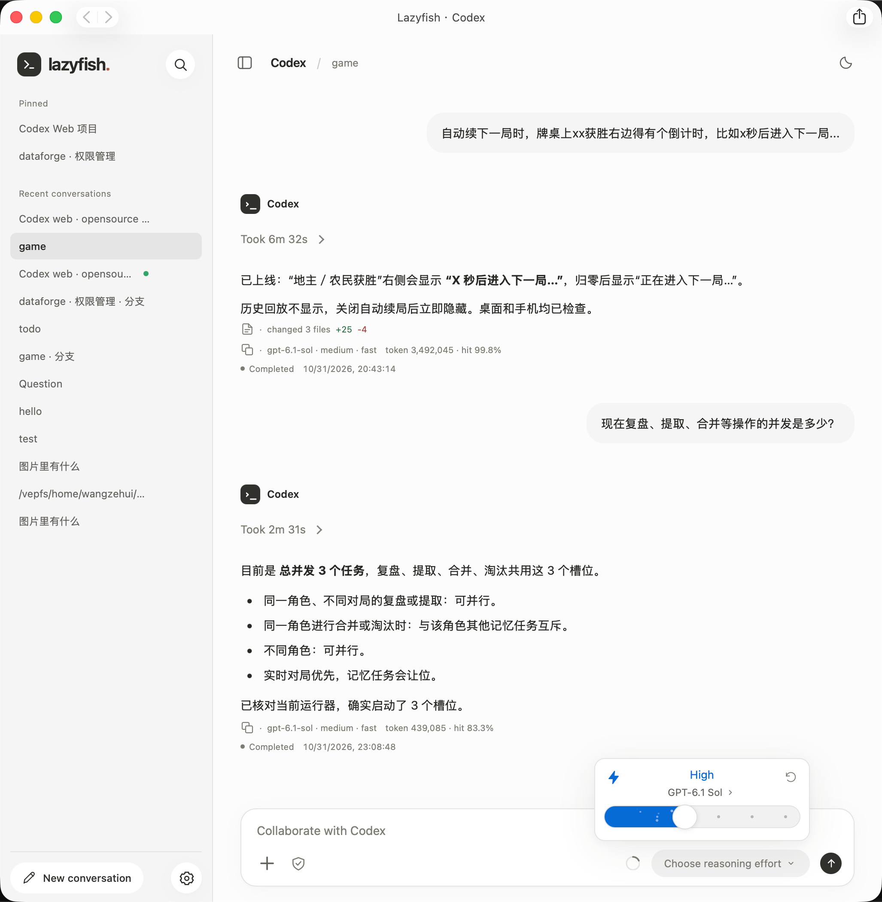

<p align="center">
  
</p>

<h1 align="center">Lazyfish</h1>

<p align="center"><strong>你的 Codex，你的记录，你的工作台。</strong></p>

<p align="center">自托管的 Codex 网页工作台：本地历史、侧边聊天、上下文由你掌控。</p>

<p align="center">
  <a href="README.md">English</a> · 简体中文<br>
  <a href="#快速开始">快速开始</a> ·
  <a href="#为什么选择-lazyfish">产品特色</a> ·
  <a href="docs/configuration.md">配置说明</a> ·
  <a href="docs/troubleshooting.md">常见问题</a>
</p>

Lazyfish 把你已有的 **Codex CLI** 变成个人网页工作台。把对话记录保存在自己掌控的机器上，在主任务旁随手展开讨论，自主决定何时压缩长对话。Codex 在你的 Linux 或 macOS 主机上工作，电脑、手机都能打开同一个工作台。

如果你正在选择 Codex 客户端，Lazyfish 把**自托管、记录自主保管和浏览器工作流**放在首位。访问设备无需安装 CLI 或桌面客户端；Lazyfish 本身**没有第三方 Python 运行时依赖**。

## 为什么选择 Lazyfish

### 对话记录，自己保管

对话、任务记录和已保存的附件，都存放在**服务主机上的 SQLite 数据库和本地文件**里。查看已保存的 Lazyfish 历史，无需重新登录 OpenAI 账号。登录失效或失去模型访问权限，不会删除这份本地记录；备份与保留多久，由你决定。

这里的“本地”指运行 Lazyfish 的机器，也可以是你管理的服务器。Lazyfish 不依赖 OpenAI 云端会话库来保存自己的历史。提示词与相关上下文仍会发送给配置的模型和工具，并受其数据政策约束；继续调用模型需要有效权限。详见[数据与访问](#数据与访问)及[备份说明](docs/deployment.md#upgrade-and-backup)。

### ChatGPT 或 API Key，在网页里登录

直接复用已有 Codex 登录，也可以在网页账户面板中登录 ChatGPT，或**填写 API Key**。远程无桌面的主机可使用设备码登录。凭据由原生 Codex 管理，Lazyfish 把支持的登录流程整合到同一个界面。

<details>
<summary>登录与额度说明</summary>

API Key 用量按服务提供方规则计费。OpenAI 桌面客户端目前也支持 API Key；Lazyfish 的价值在于自托管的网页登录与工作流程。目前 ChatGPT Pro/Business 赠送的 API credits **不覆盖通过 API Key 使用 Codex 的用量**。参见[认证说明](https://learn.chatgpt.com/docs/auth)与[赠送额度适用范围](https://developers.openai.com/api/docs/guides/chatgpt-api-credits)。

</details>

### 主动压缩，让长对话随时接着用

随时查看对话的上下文占用，直接从输入框旁**手动触发原生上下文压缩**。常用长对话可以提前整理好，为下一阶段工作留出空间，无需等到自动压缩触发。侧聊也有同样的入口。

如果订阅额度即将刷新、当前还有余量，可以考虑提前整理接下来会继续使用的长对话：等待任务结束，打开上下文指示器，选择**压缩上下文**。压缩本身可能消耗额度，具体取决于模型和历史长度；它不会把剩余额度结转，也不保证降低总成本。是否可用取决于 CLI 与服务提供方。

### 主线继续，问题在旁边聊

选中一段文字，直接发起侧边讨论：追问一个假设、拆解一个结果，或比较另一种方案。**多个侧聊标签**分别保留自己的对话、草稿和模型设置。讨论出有用的结论，再带回主输入框。

侧边讨论从创建时的主对话文本快照开始，后续消息不会自动同步。不同对话仍可能操作同一工作目录。具体行为见[功能指南](docs/features.md)。

### 换个设备，还是同一个工作台

在电脑上发起任务，用手机查看进度，再回到同一段对话。**关闭浏览器不会停止任务**，前提是主机与服务保持运行。通过本机访问或安全的远程连接，继续使用同一套项目、文件与 CLI。

## 日常使用，也照顾到细节

- **找回思路。** 项目分组、全文搜索、对话置顶、归档与恢复。编辑消息或创建分支，尝试另一条思路；这些操作不会撤销工作目录中的文件改动。
- **边做边补充。** 给执行中的任务追加指令，在不同对话中并行工作，在浏览器里回答原生问题、处理审批。
- **先看结果，再看过程。** 流式回复、图片预览和文件下载；需要时再展开命令、网页结果与文件差异。
- **沿用你的配置。** 模型、推理强度、速度、权限与 Plan 控制，图片附件、项目/个人技能及 MCP 连接。查看 CLI 提供的可用额度、用量与上下文信息。
- **调成顺手的样子。** 中英文、八套配色、浅色/深色/跟随系统，可调整面板宽度，也能自定义快捷键。

## 界面预览

| 深色外观 · 中文界面 | 浅色外观 · 英文界面 |
| --- | --- |
|  |  |

## 环境要求

- **Linux 或 macOS**，以及 Python **3.11–3.14**、`venv` 和 `pip`。
- 单独安装支持 **`app-server` 的 Codex CLI**，并确保运行 Lazyfish 的系统用户可以使用它。已有 CLI 登录会直接复用，也可以在网页账户面板中登录。
- 现代浏览器。使用下方克隆命令需要 Git，也可以下载并解压仓库。

Lazyfish 目前处于 pre-alpha 阶段。原生能力取决于 CLI 版本、账户与服务提供方；保留指定历史范围的对话分支需要 Codex CLI **0.162.1+**。已有可用的 ChatGPT 登录时，无需额外填写 API Key；API Key 用量由服务提供方单独计费。参考 [Codex CLI 文档](https://learn.chatgpt.com/docs/codex/cli)与[认证说明](https://learn.chatgpt.com/docs/auth)。

## 快速开始

### 1. 在运行 Codex 的机器上安装

```bash
git clone https://github.com/vitslam/codex-webui.git
cd codex-webui
bash scripts/install.sh
```

安装器会创建独立的 Python 环境与 `~/.local/bin/lazyfish` 命令，初始化私有配置和 Web 令牌，不会安装 Codex 或启动服务。无需 `sudo`，安装完成后请保留安装目录。

**如果安装器提示执行 `source` 命令，请先执行再继续**，也可以打开新终端，让更新后的 PATH 生效。

### 2. 启动 Lazyfish

```bash
lazyfish token
lazyfish serve
```

打开 **http://127.0.0.1:3210**，输入 `lazyfish token` 显示的令牌。这是 **Web 登录令牌**，与 Codex/OpenAI 凭据相互独立。服务在前台运行，请保持终端开启；按 Ctrl+C 可停止。

### 3. 开始第一段对话

1. 如果 Codex 尚未就绪，在网页的安装或账户面板检查状态并完成登录。
2. 新建对话，选择项目目录。未设置默认目录时，新对话从运行服务的系统用户家目录开始。
3. 选择模型和权限，描述任务。例如：*“先阅读这个项目，提出一项小改进，确认方案后再修改文件。”*
4. 跟随流式回复查看进展。任务执行中可以补充指令，也可以选中文字，打开侧边讨论深入一个细节。

在**设置**中可以指定新对话的默认工作目录。每段对话独立保存自己的目录，修改默认值不会移动已有对话。

<details>
<summary>需要指定 Python 或 Codex 路径？</summary>

安装时选择已有的 Python 解释器：

```bash
PYTHON=/path/to/python3.14 bash scripts/install.sh
```

如果 PATH 中找不到 Codex，启动时指定其可执行文件：

```bash
LAZYFISH_CODEX_BIN=/path/to/codex lazyfish serve
```

也可以在 `config.toml` 的 `[codex]` 下设置 `binary`。工作目录默认值、自定义安装位置和代理配置见[配置说明](docs/configuration.md)。

</details>

## 远程访问

Web 服务与 Codex 运行在**同一台机器**上。其他设备通过浏览器访问，无需另外部署执行节点。

**通过 SSH 访问：** 保留默认的 `127.0.0.1` 监听地址，在用来浏览的电脑上执行：

```bash
ssh -N -L 3210:127.0.0.1:3210 user@your-server
```

保持隧道开启，在本机打开 **http://127.0.0.1:3210**，使用服务器上的 Web 令牌登录。如果本机 3210 端口已被占用，可改用 `-L 3211:127.0.0.1:3210`，并访问本机 3211 端口。

**通过可信局域网访问：** 在 `~/.config/lazyfish/config.toml` 的 `[server]` 下设置 `host = "0.0.0.0"`，然后重启服务。启动时会列出可用的 IPv4 地址；在另一台设备上打开对应网址，使用 Web 令牌登录。

`0.0.0.0` 会监听所有 IPv4 网卡，HTTP 不加密流量或令牌。请用防火墙限制访问范围；不可信网络使用 SSH。支持的部署方式见[部署指南](docs/deployment.md)，指定单个 IPv4 地址的方法见[配置说明](docs/configuration.md)。

## 常用命令

| 命令 | 用途 |
| --- | --- |
| `lazyfish serve` | 在前台启动服务 |
| `lazyfish token` | 查看 Web 登录令牌 |
| `lazyfish status` | 查看当前安装实例的运行状态 |
| `lazyfish stop` | 从另一终端正常停止服务 |
| `lazyfish doctor` | 检查本机 CLI 安装和已保存的登录状态 |
| `lazyfish doctor --probe` | 额外验证 app-server 初始化，不调用模型 |
| `lazyfish token --rotate` | 在服务停止时更换 Web 令牌 |

这些命令会自动查找默认或已记住的安装配置。本机检查不验证网络、模型可用性或计费状态。自定义配置与可选的单次免登录模式见[配置说明](docs/configuration.md)。

## 数据与访问

默认配置保存在 `~/.config/lazyfish/`，对话、任务记录、附件和日志保存在 `~/.local/share/lazyfish/`。原生 Codex 自行管理登录凭据。Lazyfish 不包含分析埋点或 CDN 资源；模型请求与连接的工具仍会访问 Codex 中配置的服务。

默认要求 Web 登录，并使用 HttpOnly 浏览器会话 Cookie。请将 Web 令牌视为访问 Codex 会话与工作空间的凭证。工作目录是执行起点，**不是操作系统沙箱**；文件访问由原生沙箱权限和审批控制。这是单机个人服务，不提供多用户隔离边界。

备份、升级与访问细节见[部署指南](docs/deployment.md)、[配置说明](docs/configuration.md)和[安全政策](SECURITY.md)。

## 参与开发

```bash
python3.11 -m venv .venv
.venv/bin/python -m pip install -e .
.venv/bin/python -m unittest discover -s tests -v
```

测试使用隔离目录和模拟 Codex 可执行文件，无需真实模型调用或凭据。打包与可选的浏览器检查见 [CONTRIBUTING.md](CONTRIBUTING.md)。

## 继续了解

以下详细文档以英文维护。

| 文档 | 内容 |
| --- | --- |
| [功能指南](docs/features.md) | 侧边讨论、分支、文件、技能与原生集成限制 |
| [配置说明](docs/configuration.md) | 路径、环境变量、代理与执行设置 |
| [部署指南](docs/deployment.md) | 远程访问、升级、备份与离线安装 |
| [常见问题](docs/troubleshooting.md) | 安装、登录与运行问题 |
| [架构](docs/architecture.md) · [路线图](docs/roadmap.md) · [更新记录](CHANGELOG.md) | 实现方式、后续计划与版本变化 |

## 许可与声明

Lazyfish 采用 [MIT 许可](LICENSE)。欢迎贡献代码或提交明确的问题报告，参见[贡献指南](CONTRIBUTING.md)与[第三方声明](THIRD_PARTY_NOTICES.md)。

Lazyfish 是独立开发的第三方项目，与 OpenAI 无隶属、赞助或认可关系。OpenAI、Codex、ChatGPT 等商标归各自权利人所有。Codex 与连接的服务遵循各自的许可和使用条款。
