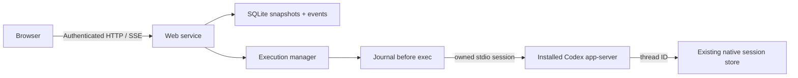

# Architecture

All service-side components run as one OS user on one Linux or macOS machine. A remote
browser uses an opt-in trusted LAN binding or an SSH tunnel. This is a single-owner installation. Runtime uses the
Python standard library and packaged browser assets, without a frontend build step.

| Boundary | Responsibility |
| --- | --- |
| `config.py`, `codex.py` | Private configuration, environment filtering, local diagnostics |
| `protocol.py` | Bounded JSONL transport, initialization, native requests/notifications |
| `execution.py`, `runtimes.py` | Native thread mapping, queued tasks, owned warm slots, cancellation and recovery |
| `approvals.py`, `run_settings.py` | Offered native decisions and validated conversation choices |
| `telemetry.py` | Loopback-only bounded sampling timings; no prompt persistence |
| `exec_guard.py`, `processes.py` | Ownership journal, lease inheritance, Linux/macOS session identity/cleanup |
| `storage.py` | Versioned SQLite, conversation/task snapshots and transactional events |
| `web/` | Authenticated APIs, read-only SSE replay and bilingual chat UI |
| `web/themes.json`, `web/themes.py` | Validated reusable palettes and generated browser theme assets |
| `runtime.py` | Exclusive service lock, lifecycle metadata and authenticated shutdown |

## Conversation and turn model

A conversation has an explicit workspace (editable while idle) and a native thread ID. Each explicit send
creates one durable job with its original prompt, model/effort and client request
ID. A partial unique index permits one active job per conversation; capacity defaults to four execution slots and is adjustable from 1 to 16.
Excess work queues, bounded to 100 active/queued tasks. Reusing a client request ID returns the existing job if its
payload matches. No request is automatically retried.

`runtimes.py` retains exclusive warm app-server slots. Each task leases a slot,
creates/resumes/forks its native thread, applies that conversation's current
workspace and permissions, and starts one turn. A slot can retain several loaded
threads; its writer affinity prevents a second executor from opening any of those
threads while the slot is borrowed. Unrelated queued work can still use other slots.
Successful healthy executors may be reused for ten minutes; cancellation, failure,
account-generation changes, retirement or unverified child processes close them.

A lasting spawn thread owns process creation: Linux parent-death signals follow the
creating thread, so creating reusable executors in a short-lived per-turn thread
would terminate them at the end of each turn. Runtime ownership is journaled before
native exec, and each task receives a journal alias before turn RPCs. Runtime and
task leases remain distinct. Shrinking concurrency retires busy slots after their
work finishes; increasing it permits queued work without replaying old tasks.

### Native process safety on Linux and macOS

Linux retains `/proc` start ticks, boot ID and machine-ID hashing, with
`PR_SET_PDEATHSIG` on the lasting spawn thread. macOS uses libproc's
`proc_bsdinfo` start time (epoch microseconds in the unchanged `start_ticks`
field), `getsid`, same-UID `proc_listpids`, `kern.bootsessionuuid`, and a hashed
`gethostuuid` value plus hostname. Identity is checked again across the separate
session lookup to reject PID reuse. Journal fields and cleanup rules are shared;
records are machine/boot-local, not portable between hosts. The boot UUID stays
fixed across wall-clock adjustments; an unavailable identity fails closed.

macOS arms a small forked kqueue guardian before exec. It watches the service and
worker exits, closes inherited descriptors (including the execution lease), and
enters a separate session so worker-session cleanup cannot kill it. Service death
triggers verified session TERM/KILL cleanup, including separate tool process
groups. Normal worker exit ends the guardian. Registration failure prevents exec.
Both platforms discover IPv4 interfaces through `getifaddrs`; container bridges
and Apple wireless-direct interfaces are hidden only in the banner, not Host checks.
VPN interfaces remain visible. Windows is not supported.

## Streaming and persistence

Item/snapshot changes and replay events commit in the same transaction. A task
snapshot includes a cursor read within its transaction. SSE replays strictly after
that cursor (or Last-Event-ID), so reconnecting does not duplicate streamed text.
Final items replace accumulated deltas. A browser connection only observes work;
its disappearance cannot cancel or replay a task.

## Lifecycle and recovery

The service lock prevents concurrent owners of one data directory. Task ownership
is written before native exec with machine/boot identity and process start time.
Normal cancellation interrupts the turn, then stops its owned native process
session before recording a terminal state. On restart, verified orphan execution
is stopped and its task marked interrupted; history/native thread mapping remain.
Unknown/foreign ownership blocks sending. There is no automatic replay or forced
unlock. See [recovery](recovery.md) and [security](../SECURITY.md).

Locally verified with Codex CLI `0.162.1`: initialization, a real text turn and a
second turn resuming the same context. Fake-protocol tests cover approvals,
stream/reconnect, cancellation, native failure and forced service restart. This is
not a promise to support every experimental native method or future CLI version.

Protocol reference: [official Codex App Server documentation](https://learn.chatgpt.com/docs/app-server).

## Paginated history and forks

Schema 3 adds pinning and fork lineage without changing existing task/native IDs.
Transcript pages use immutable job IDs with SQLite rowid keysets, not offsets;
an anchor request loads a window around the saved reading position. If execution
is outside that window, its snapshot is returned separately for cancellation and
SSE observation. Conversation pages sort pinned first, then update time and ID.

Branch creation is one transaction: copy terminal jobs/items before the selected
user job, save source lineage and the last included native turn, and return an idle
conversation. Request IDs make retries idempotent. The first explicit send calls
`thread/fork` with `lastTurnId` (inclusive); an empty prefix uses `thread/start`.
Subsequent sends resume the new thread. No source rollback, inference on creation,
or filesystem rewind occurs. Retained native history must be available; CLI
`0.162.1` is the locally verified fork protocol baseline.

The frontend stores bounded message/offset anchors and a separate bottom-intent
flag. DOM updates and resize observations restore that intent without relying on
an old scrollTop after Markdown reflow. Language, shortcuts and geometry stay in
the browser; authentication and message bodies are never placed in local storage.

The visual layer reuses the original Lazyfish components and SVG symbols. Theme
palettes live in one packaged JSON registry; the server validates it and publishes
CSS/metadata without reading installation secrets. The small appearance bootstrap
applies a saved/system palette before rendering the app. The local chat adapter
keeps existing message IDs, events, approvals and scroll anchors.

## Native panels and composer inputs

`capabilities.py` serializes and caches native account/quota/model/skill/MCP reads.
Each inspection initializes an owned app-server, calls only an explicit method,
and closes it without starting a thread or turn. Responses allowlist display fields;
credentials and MCP configuration are never returned. Shutdown cancels pending reads.

Schema 4 adds image blobs, job input references and conversation context usage.
Image uploads have authenticated same-origin writes, a 10 MiB limit and PNG/JPEG/WebP
signature checks. Native `localImage` files are atomically materialized with private
permissions inside the data directory. Skill selections are validated against native
discovery, rechecked before send, and transmitted as native skill inputs. Input payloads
participate in send idempotency and are copied when branching. Workspace changes are
allowed while a conversation is idle and are independent of the server-wide new-chat default. The default is persisted in installation settings with a revision for cross-browser synchronization; existing conversation records are never rewritten by a default update.

Workspace skill editing writes only direct, non-symlink `.agents/skills/<slug>/SKILL.md`
files. Other discovered documents are read-only. Enabling/disabling a discovered skill
uses the native `skills/config/write` method. This does not make project content trusted;
users should review skill instructions before selecting them.

The run control reuses the original pointer and model-picker interactions in
`web/static/run-settings.js`. Model names, supported efforts and reset defaults come
from native metadata. Speed is part of the durable input payload, idempotency check
and branch copy. Turns with an explicit speed choice opt into the native experimental
API and use `serviceTierForTurn` without modifying the CLI's configuration. The local
CLI's generated schema is the reference for that field; fake-native tests verify both
fast and standard requests. Model/effort/fast browser preferences contain no credentials.

## Reference UI adapter

The browser ports reference components and labels rather than replacing them with
simpler lookalikes. Permission presets map onto native thread sandbox/approval/reviewer
settings. Plan uses native `collaborationMode`; manual compaction reserves an ordinary
owned job and calls `thread/compact/start`, with the same cancellation/recovery path.
Compaction does not send a synthetic user prompt or clear visible history.

## Remaining reference flows

Schema 6 adds item details, reports/artifact blobs, pin order, instructions,
questions and edit audit records without rewriting old job/native IDs. Editing
retires the visible suffix transactionally and records an idempotent replacement
job; its native execution forks at the retained turn boundary. It is not a Git or
filesystem rollback. Steering/answers go through the owning worker's outbound
queue, avoiding concurrent writes to native stdio.

`outputs.py` extracts typed images and snapshots permitted local Markdown links
into authenticated hash-addressed artifacts. Normalized tool records strip binary
payloads before event persistence. `changes.py` uses read-only bounded Git snapshots;
reports and native token usage share durable job reports. `auth_sessions.py` retains
an owned native process for account/MCP callbacks, with timeout/cancellation and
identity-checked shutdown/recovery. Credential storage belongs to Codex, not SQLite.

The browser reuses `steps`, `changes`, `artifacts`, `message-view`, `composer-dock`
and `sidebar-order` reference components. `experience.js` adapts local durable
snapshots/events into those components; unsupported tool records remain bounded
and expandable. UI labels retain native plural forms in both languages.

## Refresh and cached views

Versioned assets are prepared at service startup; HTML/data stay uncached and
contain references to content hashes. Native display snapshots live in schema 7,
with an installation/account epoch, per-workspace skills, coalesced inspection and
stale-while-refresh presentation. Native credentials never enter those snapshots.
History pages batch related reads in a single transaction. Browser summary reads
omit terminal process items and full diffs; disclosure fetches bounded item pages.
Live turns still receive full snapshots and replay from consistent event cursors.
The browser retains six recent views, skips unchanged terminal DOM, restores scroll
anchors immediately and reconciles server edits using a history revision. Neither
reload nor a cached view starts a native turn.

## Reference audit completion

Schema 8 adds conversation run choices, read receipts/revisions, idempotent creation,
image sizes, instruction skills, offered approval decisions, command-detail versions,
local concurrency and request timings. The 7 → 8 migration/backfill commits atomically
without replacing history or native IDs. Conversations have a structural SSE stream
plus a revision polling fallback; task text continues using the existing cursor stream.
Commands send light previews and load independent versioned bodies only on expansion.

The loopback collector receives native OTLP JSON traces but keeps only sampling
trace/span/turn IDs, elapsed time, finish time and failure state. Prompts, headers,
credentials and other attributes are discarded. Timings are deduplicated and retained
for 30 days; the chart displays the latest 20 matched requests, excluding fork copies.
No remote collector or analytics account is required.
