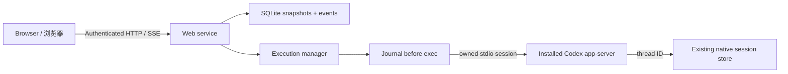

# Architecture / 架构

All service-side components run as one OS user on one Linux machine. A remote
browser uses an opt-in trusted LAN binding or an SSH tunnel. This is a single-owner installation. Runtime uses the
Python standard library and packaged browser assets, without a frontend build step.

服务端在同一台 Linux 机器、同一系统用户下运行。远程浏览器通过显式开启的可信局域网绑定或 SSH 隧道访问，面向
单用户。运行时只有 Python 标准库及静态资源，无需前端构建。

| Boundary / 边界 | Responsibility / 职责 |
| --- | --- |
| `config.py`, `codex.py` | Private configuration, environment filtering, local diagnostics |
| `protocol.py` | Bounded JSONL transport, initialization, native requests/notifications |
| `execution.py`, `runtimes.py` | Native thread mapping, queued tasks, owned warm slots, cancellation and recovery |
| `approvals.py`, `run_settings.py` | Offered native decisions and validated conversation choices |
| `telemetry.py` | Loopback-only bounded sampling timings; no prompt persistence |
| `exec_guard.py`, `processes.py` | Ownership journal, lease inheritance, Linux session identity/cleanup |
| `storage.py` | Versioned SQLite, conversation/task snapshots and transactional events |
| `web/` | Authenticated APIs, read-only SSE replay and bilingual chat UI |
| `web/themes.json`, `web/themes.py` | Validated reusable palettes and generated browser theme assets |
| `runtime.py` | Exclusive service lock, lifecycle metadata and authenticated shutdown |

## Conversation and turn model / 对话和轮次

A conversation has an explicit workspace (editable while idle) and a native thread ID. Each explicit send
creates one durable job with its original prompt, model/effort and client request
ID. A partial unique index permits one active job per conversation; capacity defaults to four execution slots and is adjustable from 1 to 16.
Excess work queues, bounded to 100 active/queued tasks. Reusing a client request ID returns the existing job if its
payload matches. No request is automatically retried.

每个对话保存可在空闲时修改的工作目录并绑定原生 thread。每条显式发送对应一个持久任务，保存原文、模型、
推理选项及请求编号。数据库保证同一对话一个活动任务；默认四个执行槽，可调整为 1–16 个，
额外任务排队，活动及排队合计最多 100 个。相同请求编号
返回原任务，不重复调用；没有自动重试。

`runtimes.py` retains exclusive warm app-server slots. Each task leases a slot,
creates/resumes/forks its native thread, applies that conversation's current
workspace and permissions, and starts one turn. A slot can retain several loaded
threads; its writer affinity prevents a second executor from opening any of those
threads while the slot is borrowed. Unrelated queued work can still use other slots.
Successful healthy executors may be reused for ten minutes; cancellation, failure,
account-generation changes, retirement or unverified child processes close them.

`runtimes.py` 持有独占的预热 app-server 执行槽。每轮应用当前对话的目录和权限，
原生创建、恢复或分支会话，不拼接旧文本来代替原生上下文。执行槽记录所有已加载会话的
写入归属；即使被其他对话借用，也不会为原会话另开第二个写入者，不相关任务可使用别的槽。
健康完成后可复用，空闲十分钟、取消、失败、换号、缩容或残留子进程时关闭。

A lasting spawn thread owns process creation: Linux parent-death signals follow the
creating thread, so creating reusable executors in a short-lived per-turn thread
would terminate them at the end of each turn. Runtime ownership is journaled before
native exec, and each task receives a journal alias before turn RPCs. Runtime and
task leases remain distinct. Shrinking concurrency retires busy slots after their
work finishes; increasing it permits queued work without replaying old tasks.

原生进程由持续存活的专用线程创建，避免 Linux 父线程退出信号在每轮线程结束时误杀
可复用进程。执行前先写归属日志，轮次 RPC 前再建立任务别名，执行槽及任务分别持有租约。
缩容让忙碌槽完成后退出，扩容只调度当前排队任务，不重跑旧任务。

## Streaming and persistence / 流式与持久化

Item/snapshot changes and replay events commit in the same transaction. A task
snapshot includes a cursor read within its transaction. SSE replays strictly after
that cursor (or Last-Event-ID), so reconnecting does not duplicate streamed text.
Final items replace accumulated deltas. A browser connection only observes work;
its disappearance cannot cancel or replay a task.

快照和事件同事务提交，快照返回一致的事件编号；SSE 从编号之后重放，避免文本重复。
最终 item 覆盖累计片段。浏览器连接仅观察执行，断开不取消、不重跑。

## Lifecycle and recovery / 生命周期与恢复

The service lock prevents concurrent owners of one data directory. Task ownership
is written before native exec with machine/boot identity and process start time.
Normal cancellation interrupts the turn, then stops its owned native process
session before recording a terminal state. On restart, verified orphan execution
is stopped and its task marked interrupted; history/native thread mapping remain.
Unknown/foreign ownership blocks sending. There is no automatic replay or forced
unlock. See [recovery](recovery.md) and [security](../SECURITY.md).

服务锁防止数据目录双写。原生执行前记录归属及身份；确认收尾后才能记录终态。重启时
只清理可验证的旧执行，保留历史和原生会话，不自动重跑，不强制解锁。

Locally verified with Codex CLI `0.162.1`: initialization, a real text turn and a
second turn resuming the same context. Fake-protocol tests cover approvals,
stream/reconnect, cancellation, native failure and forced service restart. This is
not a promise to support every experimental native method or future CLI version.

Protocol reference: [official Codex App Server documentation](https://learn.chatgpt.com/docs/app-server).

本机以 CLI `0.162.1` 完成了真实两轮续聊；模拟协议测试覆盖审批、重连、取消、失败及强制
重启。不承诺支持所有实验性方法或未来任意 CLI 版本。

## Paginated history and forks / 分页与分支

Schema 3 adds pinning and fork lineage without changing existing task/native IDs.
Transcript pages use immutable job IDs with SQLite rowid keysets, not offsets;
an anchor request loads a window around the saved reading position. If execution
is outside that window, its snapshot is returned separately for cancellation and
SSE observation. Conversation pages sort pinned first, then update time and ID.

第三版数据库保留现有任务及原生 ID。历史使用 job ID 定位和 rowid 游标，避免偏移分页
插入导致重读。锚点可直接载入阅读位置附近；不在窗口内的活动任务单独返回，仍能停止和
观察执行。对话列表按置顶、更新时间和 ID 排序。

Branch creation is one transaction: copy terminal jobs/items before the selected
user job, save source lineage and the last included native turn, and return an idle
conversation. Request IDs make retries idempotent. The first explicit send calls
`thread/fork` with `lastTurnId` (inclusive); an empty prefix uses `thread/start`.
Subsequent sends resume the new thread. No source rollback, inference on creation,
or filesystem rewind occurs. Retained native history must be available; CLI
`0.162.1` is the locally verified fork protocol baseline.

分支创建同事务复制选中用户消息之前的终态记录，保存来源及最后保留的原生轮次，返回空闲
会话。请求编号防止重复分支。首次发送才原生 fork（包含指定 lastTurnId）；空前缀新建
thread。后续恢复新 thread，不回滚原对话，不回滚文件，也不在创建时调用模型。

The frontend stores bounded message/offset anchors and a separate bottom-intent
flag. DOM updates and resize observations restore that intent without relying on
an old scrollTop after Markdown reflow. Language, shortcuts and geometry stay in
the browser; authentication and message bodies are never placed in local storage.

前端限制本地保存的消息锚点数量，区分底部跟随与历史阅读。DOM 更新和布局变化按锚点
恢复，不依赖旧 scrollTop；本地存储只含偏好和几何信息，不含认证或消息正文。

The visual layer reuses the original Lazyfish components and SVG symbols. Theme
palettes live in one packaged JSON registry; the server validates it and publishes
CSS/metadata without reading installation secrets. The small appearance bootstrap
applies a saved/system palette before rendering the app. The local chat adapter
keeps existing message IDs, events, approvals and scroll anchors.

视觉层直接复用原 Lazyfish 组件和 SVG 图标。配色统一保存在打包的 JSON 注册表中，
服务验证后生成 CSS 与元数据，不读取安装密钥。轻量脚本在页面绘制前应用保存或系统配色；
本机聊天适配层保留原有消息 ID、事件、审批和滚动锚点。

## Native panels and composer inputs / 原生面板与输入

`capabilities.py` serializes and caches native account/quota/model/skill/MCP reads.
Each inspection initializes an owned app-server, calls only an explicit method,
and closes it without starting a thread or turn. Responses allowlist display fields;
credentials and MCP configuration are never returned. Shutdown cancels pending reads.

原生信息读取由独立适配层串行执行，缓存 60 秒，只调用明确的方法，读取后清理进程，
不创建会话或执行轮次。API 仅返回白名单显示字段，退出服务时终止未完成读取。

Schema 4 adds image blobs, job input references and conversation context usage.
Image uploads have authenticated same-origin writes, a 10 MiB limit and PNG/JPEG/WebP
signature checks. Native `localImage` files are atomically materialized with private
permissions inside the data directory. Skill selections are validated against native
discovery, rechecked before send, and transmitted as native skill inputs. Input payloads
participate in send idempotency and are copied when branching. Workspace changes are
restricted to the configured root and allowed only before any native thread/history.

第四版数据库新增图片、消息输入引用和上下文快照。上传需认证及同源写入，限制大小与格式；
原生图片文件在数据目录内以私有权限原子写入。技能按原生发现结果校验后发送。图片/技能
参与发送幂等比较，分支保留输入引用。工作目录只能在配置根目录内且对话尚未开始时调整。

Workspace skill editing writes only direct, non-symlink `.agents/skills/<slug>/SKILL.md`
files. Other discovered documents are read-only. Enabling/disabling a discovered skill
uses the native `skills/config/write` method. This does not make project content trusted;
users should review skill instructions before selecting them.

项目技能只写入 `.agents/skills/<名称>/SKILL.md`，拒绝符号链接及越界路径；其他已发现
技能只读，启用/停用交给原生接口。技能内容仍需用户审核。

The run control reuses the original pointer and model-picker interactions in
`web/static/run-settings.js`. Model names, supported efforts and reset defaults come
from native metadata. Speed is part of the durable input payload, idempotency check
and branch copy. Turns with an explicit speed choice opt into the native experimental
API and use `serviceTierForTurn` without modifying the CLI's configuration. The local
CLI's generated schema is the reference for that field; fake-native tests verify both
fast and standard requests. Model/effort/fast browser preferences contain no credentials.

运行控件复用原版拖动及模型列表交互。名称、档位和默认值读取原生信息；速度随任务保存并
参与幂等比较、分支复制。指定速度的轮次声明实验接口并使用 `serviceTierForTurn`，不修改
CLI 配置。字段以本机 CLI 生成的协议为准，模拟测试覆盖快速和标准两种参数。
浏览器保存的模型、推理及速度偏好不包含凭据。

## Reference UI adapter / 原版界面适配

The browser ports reference components and labels rather than replacing them with
simpler lookalikes. Permission presets map onto native thread sandbox/approval/reviewer
settings. Plan uses native `collaborationMode`; manual compaction reserves an ordinary
owned job and calls `thread/compact/start`, with the same cancellation/recovery path.
Compaction does not send a synthetic user prompt or clear visible history.

浏览器复用原版组件与文案。权限映射到原生沙箱、审批策略与审批方；Plan 通过原生
`collaborationMode` 传递。手动压缩复用任务归属、取消与恢复链路，调用 `thread/compact/start`，
不拼接用户提示、不清空网页历史。界面删除只设置列表归档标志，不删除原生会话或工作目录。

## Remaining reference flows / 完整原版链路

Schema 6 adds item details, reports/artifact blobs, pin order, instructions,
questions and edit audit records without rewriting old job/native IDs. Editing
retires the visible suffix transactionally and records an idempotent replacement
job; its native execution forks at the retained turn boundary. It is not a Git or
filesystem rollback. Steering/answers go through the owning worker's outbound
queue, avoiding concurrent writes to native stdio.

`outputs.py` extracts typed images and snapshots permitted local Markdown links
into authenticated hash-addressed artifacts. Normalized tool records strip binary
payloads before event persistence. `changes.py` uses read-only bounded Git snapshots;
reports and native token usage share durable job reports. `auth_sessions.py` retains
an owned native process for account/MCP callbacks, with timeout/cancellation and
identity-checked shutdown/recovery. Credential storage belongs to Codex, not SQLite.

The browser reuses `steps`, `changes`, `artifacts`, `message-view`, `composer-dock`
and `sidebar-order` reference components. `experience.js` adapts local durable
snapshots/events into those components; unsupported tool records remain bounded
and expandable. UI labels retain native plural forms in both languages.

schema 6 增加详情、报告产物、排序、补充指令、提问和编辑审计，保留旧任务/原生编号。
编辑事务化退休后缀并保留前缀分支，不回滚文件；补充指令和答案由执行线程独占写原生
通道。类型化产物共用授权快照链路，原始二进制在持久化事件前移除。授权回调持有归属
明确的原生进程，超时/取消/重启均不重放；凭据存储仍归 Codex。界面通过适配器复用
原版组件及中英文复数文案。

## Refresh and cached views / 刷新与视图缓存

Versioned assets are prepared at service startup; HTML/data stay uncached and
contain references to content hashes. Native display snapshots live in schema 7,
with an installation/account epoch, per-workspace skills, coalesced inspection and
stale-while-refresh presentation. Native credentials never enter those snapshots.
History pages batch related reads in a single transaction. Browser summary reads
omit terminal process items and full diffs; disclosure fetches bounded item pages.
Live turns still receive full snapshots and replay from consistent event cursors.
The browser retains six recent views, skips unchanged terminal DOM, restores scroll
anchors immediately and reconciles server edits using a history revision. Neither
reload nor a cached view starts a native turn.

静态资源启动时生成内容版本；HTML 和业务数据不公开缓存。schema 7 保存脱敏展示快照，
区分原生账户版本与工作目录，合并后台查询。历史在同事务批量读取，首屏摘要省去已完成
任务的过程详情与完整 diff，展开后分页读取；活动任务仍使用完整快照与事件游标。页面内
保留六个最近视图，用编辑版本及游标校正，恢复阅读锚点，不因刷新或缓存重放任务。

## Reference audit completion / 审计补迁

Schema 8 adds conversation run choices, read receipts/revisions, idempotent creation,
image sizes, instruction skills, offered approval decisions, command-detail versions,
local concurrency and request timings. The 7 → 8 migration/backfill commits atomically
without replacing history or native IDs. Conversations have a structural SSE stream
plus a revision polling fallback; task text continues using the existing cursor stream.
Commands send light previews and load independent versioned bodies only on expansion.

数据库第 8 版增加对话运行设置、已读标记、修订号、创建去重、图片尺寸、补充技能、
审批选项、命令正文版本、并发及请求耗时。7 → 8 升级和回填在同一事务完成，保留历史及
原生编号。对话结构通知与轮次文本流分开，断线通过修订轮询兜底；命令正文展开后独立增量读取。

The loopback collector receives native OTLP JSON traces but keeps only sampling
trace/span/turn IDs, elapsed time, finish time and failure state. Prompts, headers,
credentials and other attributes are discarded. Timings are deduplicated and retained
for 30 days; the chart displays the latest 20 matched requests, excluding fork copies.
No remote collector or analytics account is required.

本机回环采集器只持久化采样请求的关联编号、耗时、完成时间和失败状态，丢弃提示词、
请求头、凭据及其他属性。去重保留 30 天，图表展示可关联到任务的最近 20 次请求，
不重复计算分支副本，无需外部采集服务。
